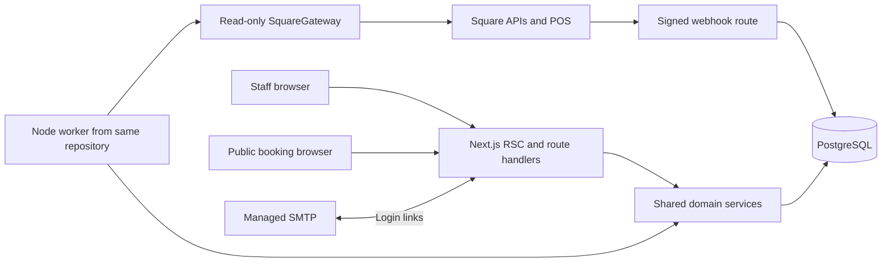

# RestaurantOS architecture

Planning baseline: 2026-11-04, America/Los_Angeles. Status: implementation specification, not implemented software. Read with [PRD](PRD.md), [database](DATABASE.md), [API](API_CONTRACTS.md), [Square](SQUARE_INTEGRATION.md), [UI](UI_DESIGN.md), [tests](TESTING.md), and [tasks](IMPLEMENTATION_TASKS.md).

## 1. Binding decisions and precedence

These documents refine `RESTAURANT_OS_CODEX_PLAN.md`. The current request authorizes planning only; its embedded Phase 1 kickoff is an example, not an instruction to execute. These eight uppercase documents are canonical; do not create competing lowercase architecture documents. Resolve disagreements using this decision register, then the owning domain document; stop a task and record a decision if an unresolved contradiction affects integrity.

| ID | Decision |
| --- | --- |
| A01 | Modular monolith: one Next.js repository, one PostgreSQL database, one worker executable using the same domain modules. No microservices, Redis, event bus, warehouse, or public SaaS in v1. |
| A02 | Square owns catalog, orders, payments, refunds, and native POS checks. RestaurantOS reads Square and owns its own reservations and raw-ingredient operations. Square Free and Plus use identical feature paths. |
| A03 | One seeded restaurant, one active location and USD in v1; tenant/location keys and authorization remain mandatory. Do not expose multi-tenant registration or multi-location switching. |
| A04 | Auth.js email magic links with Prisma adapter and database sessions; invite-only identities, managed SMTP, no password authentication. Session maximum 12 hours; magic link maximum 15 minutes. An active membership is rechecked on every server operation. |
| A05 | v1 Square credential is an own-merchant personal token in deployment secrets. DB holds secret reference, never token. Token itself is unrestricted; code allowlists reads. Merchant-facing OAuth is deferred, with future design in Square document. |
| A06 | Pin `square@46.0.0` and Square API `2026-09-16`. Exact application/toolchain versions, compatibility evidence, and remaining verification gates are recorded in [DEPENDENCY_BASELINE](DEPENDENCY_BASELINE.md); the lockfile is created in T002. Never silently substitute unverified major versions. PostgreSQL 17 is the deployment baseline; required `btree_gist` must be available. |
| A07 | Money is signed bigint minor units internally and decimal integer strings in JSON. Quantities are Decimal(20,6); ingredient cost rates Decimal(24,12). USD only. Dedicated decimal arithmetic uses 50 significant working digits and half-up rounding, including negative ties away from zero; quantize only at specified boundaries and reject storage overflow before insert. No floating-point accounting. |
| A08 | Append-only inventory history and immutable published recipes/cost snapshots. Order-source revisions recompute desired consumption and append deltas. Request keys and source projection keys solve different duplicate problems. |
| A09 | Financial refunds never automatically restore prepared ingredients. Source quantity correction/cancellation may reverse theoretical consumption. Explicit recoverable stock corrections require actor/reason. Refund allocation uncertainty is displayed, not guessed. This refines the source plan's broad wording about refund reversals. |
| A10 | A posted physical count is a new physical balance anchor. Late sales dated at/before that anchor remain in historical theoretical usage and do not reduce current stock again. |
| A11 | Reservations atomically claim every physical table in a chosen combination, under a per-location configuration row lock and PostgreSQL exclusion constraint. The public availability result is advisory, not a hold. |
| A12 | Business mutations use the HTTP contracts in API_CONTRACTS. Server Components call read services directly; authenticated forms call these route handlers. Do not build a second independently authorized Server Action API. Auth.js may use its supported built-in actions. |
| A13 | Raw Square payload retention is disabled by default. Store allowlisted normalized fields, source hashes and sanitized diagnostics. No PAN, card tokens, OAuth/personal tokens, guest contact details in logs, or marketing automation. |
| A14 | No retroactive changes to restaurant timezone/cutoff, published recipes or posted inventory. Version configuration and use it prospectively; historic reclassification is an explicit audited maintenance job. |

## 2. Runtime and module boundaries



Use `app/` at repository root, not a second `src/app/`. Root `src/` contains shared code. Node runtime for Prisma, Auth.js, crypto, webhook and integration routes; no Edge runtime for these. Mark server modules with `server-only`. Browser code receives DTOs, never Prisma records or Square SDK objects.

| Path | Owns / may depend on |
| --- | --- |
| `app/(auth)/login`, `app/api/auth/[...nextauth]` | Auth.js boundary, generic login status; auth service only. |
| `app/(dashboard)/...` | Protected layouts, RSC reads, client form islands. Calls service/query DTOs; no business SQL. |
| `app/(public)/book/[restaurantSlug]` | Public booking UI; minimal published configuration only. |
| `app/api/v1/` | Zod request/response validation, AuthContext, rate limit, shared errors, HTTP semantics. |
| `app/api/webhooks/square/route.ts` | Exact raw-body signature verification and durable inbox insertion only. |
| `src/contracts/` | Zod DTOs and enums, browser-safe. No secret/env/DB imports. |
| `src/lib/money.ts`, `units.ts`, `business-time.ts` | Pure decimal, conversion and IANA timezone functions. |
| `src/server/auth/` | Auth.js adapter/config, invitation provisioning, scoped policy checks. |
| `src/server/db/` | Prisma singleton, transaction helpers, parameterized SQL for locks/exclusions. |
| `src/server/audit/`, `idempotency/` | Transactional audit append, request replay protocol. |
| `src/server/jobs/` | Claim, lease, retry, schedule, fencing, dead-letter/replay; no domain rules. |
| `src/server/square/` | Credentials resolver, gateway, normalized imports, cursors, reconciliation. Cannot call inventory repository directly. |
| `src/server/ingredients/`, `recipes/` | Ingredient/package/cost history; recipe publication and sale cost snapshots. |
| `src/server/purchasing/` | Supplier/PO/receipt transitions; calls inventory posting service inside same transaction. |
| `src/server/inventory/` | Sole writer of movements, counts, sale consumption states; per-ingredient locks. |
| `src/server/reservations/` | Availability, booking configuration, table allocation, waitlist, retention. |
| `src/server/reporting/` | Read projections, refund allocations, quality/freshness; no Square writes or ledger mutation. |
| `src/server/operations/` | Health, exports, retention, owner recovery commands. |
| `src/worker/main.ts`, `scripts/` | Worker startup and operator commands; reuse domain authorization/context, no duplicated rules. |
| `src/components/ui/`, `src/components/domain/` | Owned shadcn primitives and domain displays per UI_DESIGN. |

Services accept `AuthContext {userId, restaurantId, locationIds, role, requestId}` for humans or `SystemContext {restaurantId,locationId,jobId,reason}` for jobs. Do not trust tenant/location/role fields from a request. Repository functions require scope; never export an unscoped `findUnique(id)` to route code. Related IDs must pass composite FK and same-scope lookups. A background job receives scope when enqueued by trusted code and validates connection ownership again when executing.

## 3. Authentication, authorization and privacy

Bootstrap an owner with a CLI requiring deployment operator access and explicit email, restaurant name and timezone. Production seed creates no passwords, demo users or bypass routes. Owner invites other staff by creating a user/membership and sending the ordinary login flow; unknown login emails always receive the same generic response and no usable account. No self-registration. Prevent suspension/demotion of the last active OWNER in one locked transaction. Logout removes session; membership removal immediately rejects an existing session. Reauthentication within 15 minutes is required for credential configuration, role changes, and contact-bearing host-sheet exports. Credentials remain operator-supplied secret references; the UI never accepts a token into an ordinary JSON settings form.

Use Secure, HttpOnly, SameSite=Lax cookies on production HTTPS. Follow Auth.js CSRF protocol. Custom staff writes require same-origin `Origin` and a session-bound CSRF token header, plus content-type validation. Store a random 32-byte synchronizer token on each database session, expose it only through authenticated no-store GET `/api/v1/csrf`, and compare headers in constant time. Rotate on login and require reauthentication for legacy sessions without a token. Public booking uses same-origin checks, persistent rate limits and a honeypot, not staff CSRF credentials. Disable cross-origin CORS by default. Never implement a production `X-User-Id` or role override. Dev email sink and fake Square adapter require explicit nonproduction configuration and must fail startup in production.

Role permissions, including report visibility and guest contacts, are the PRD matrix. UI hiding is only presentation. Lists, aggregate reports, exports, actions, job status and error paths all enforce policies. Foreign or inaccessible IDs return 404; an accessible resource with disallowed operation returns 403. Authenticated query results use `Cache-Control: private, no-store`; do not place tenant data in a shared Next cache. Public published settings may be cached for 60 seconds; availability/booking and confirmation are `no-store`.

Reservation contact data is operational PII, not a marketing list. Require acknowledgement of booking/privacy terms and optional separate marketing opt-in default false; v1 does not send marketing. Retain contacts/notes for 90 days after terminal_at, otherwise after a past expected end (waitlist joined_at fallback), then redact on a daily job. Editing a record never extends retention; protect future active bookings. Keep deidentified operational dates/party sizes and audit action metadata. Payment/order snapshots must omit customer email/phone/address. Retain operational financial/ledger/audit data for seven years as a product policy to be reviewed by the operator, not a statement of legal requirements. Idempotent response bodies containing contacts are encrypted at rest using the managed DB and deleted within seven days; short-lived public key replay is 24 hours. Backups follow provider retention and must age out redacted PII within 35 days. No guest PII in analytics/tracing/error trackers.

## 4. Durable work and synchronization

Web request enqueues a `jobs` row and returns 202. Webhook commits inbox row plus job then returns 200 within ten seconds. No unawaited promises after response. Worker runs the same application release as the web, against the same DB. Default deployment: Vercel web + small managed always-on Node worker + managed PostgreSQL with pooling; web provider may be replaced with a Node container without code changes. Worker is a deployment process, not a separately owned service.

Worker algorithm:

1. Claim ready row using `FOR UPDATE SKIP LOCKED`; set RUNNING, unique lease token, attempts, `lease_expires_at=now+120s`.
2. Perform one bounded page/task with 45-second network budget; heartbeat every 30 seconds. Never hold a DB transaction during a Square request.
3. In a short transaction verify lease token/unexpired ownership; upsert source rows, append downstream durable job and checkpoint, then mark page complete. A recovered stale worker cannot commit.
4. Retry 429 according to Retry-After when available and use jittered exponential backoff for transient errors (base 2s, cap 15min, eight attempts). Pause connection for 401/403; do not exhaust retries on invalid credentials. Payload validation failures become visible terminal issues, not silently discarded rows.
5. Expired leases become eligible for retry. DEAD jobs are visible to owner; replay creates a new attempt retaining original source identity and audit record.

Unique job dedupe keys cover logical work: connection/entity/window/page for sync, source canonical revision for projection, event ID for inbox processing. Different jobs can discover the same Square order: uniqueness and version guards remain the final authority. Use a per-connection/location advisory transaction lock while committing canonical imports/projections; inventory writes lock affected ingredient rows in UUID order. Consistent lock order: location integration projection lock, then source/order row, then ingredient rows. Booking has its own configuration lock and never takes inventory locks.

Worker schedules insert due jobs under a unique schedule occurrence key: poll every 15 minutes with 15-minute overlap; nightly preceding seven restaurant business days; weekly preceding 90 days. Initial 90-day backfill uses daily frozen windows. Catalog, orders, payments and refunds have independent freshness/watermarks. A cursor checkpoint is not a completed watermark. Completion advances only after all pages commit. Restart invalid cursors from the same frozen window. Details and evidence are in SQUARE_INTEGRATION.

Source import transaction also enqueues `REBUILD_SALE_PROJECTION` for changed sale revisions. Projection may lag ingestion; dashboard freshness includes both ingestion and projection completion. A successful API fetch with a failed projection is not healthy. Startup recovery scans imported revisions lacking a projected state. Polling and reconciliation cover webhook downtime, including outages beyond Square's retry horizon.

## 5. Sale, recipe, costing and physical inventory flow

### Sale identity and recognition

Only each completed Order's own positive `line_items` represent sale units. OPEN/DRAFT/CANCELED orders remain normalized source records but do not count as finalized menu sales. Preserve named unexpected states as an integration issue. Recognition time is `closed_at`; missing close time is a data-quality exception requiring refetch, not an invented device timestamp. Offline `created_at` may be arrival time. Payments are a separate cashflow view, not a second sale. Return orders retain `returns` links; those structures do not introduce duplicate original sales. Exchanges can have new sale lines. Source UID + order ID identifies a line even if catalog IDs are absent.

Square catalog variations map to recipes, not parent items. Custom lines/unmapped variations/modifiers remain unknown. For v1 recipes contain ingredients only, without recursive subrecipes. Each version has effective start, portions yielded, base components and explicit modifier deltas. Amount for an ingredient per sold unit is `component_base_quantity / (yield_portions * (1-loss_fraction))`; loss fraction is 0 <= value < 1. Ingredient quantities already express purchased usable base units, with loss applied once. Modifier deltas are signed per sold unit; reject any negative final ingredient requirement for a configured combination. Unknown selected modifiers make that line's cost incomplete unless explicitly acknowledged as having no ingredient effect. Modifier quantity handling is verified against Square fixtures.

Publishing creates an immutable future/current effective version under lock; never edits prior history. Cost engine selects the version effective at sale close and the most recent recorded ingredient cost effective at/before sale close. Receipt costs are actual ingredient acquisition costs excluding sales taxes, delivery and fees; those remain separately reported expense metadata, not silently allocated. A manager can record an opening/manual basis with date, reason and audit; this does not move stock. Null cost is unknown, zero is a legitimate explicitly recorded free ingredient. Recipe-less history before the first version remains unknown unless owner runs an audited explicit historical mapping job with preview and bounded range. Such replay creates new snapshots and preserves superseded snapshots.

Persist sale cost snapshots with source revision hash, recipe version IDs, component quantities, cost-basis IDs/rates, rounded aggregate cost cents, missing reasons and calculation version. Expand and coalesce each ingredient's desired quantity per sale line at high precision, then round once to six decimal base-unit places, half-up. Use that exact rounded quantity for both consumption and its cost calculation. Sum quantity-times-rate costs at high precision and round once per sale line to cents; line cost sums yield report cost. Do not recompute old sales from today's purchase price.

### Consumption delta and count anchors

Compute desired cumulative theoretical consumption per canonical sale line and ingredient. Store previous desired totals in locked `sale_consumption_states`; append only `new_desired - previous_desired`, with movement sign negative for consumption. Dedupe by `(sale line, projection revision, ingredient)`. Order quantity decreases/cancellation append positive reversal; refunds alone do not change this desired quantity. Publishing a recipe affects new effective sales; an authorized replay may append history corrections without mutating originals. Source ingestion commits first with a durable projection job. A later projection transaction validates the current canonical source revision and atomically commits cost snapshot, desired state, movements and audit; a superseded source revision aborts/requeues that projection.

Quantity completeness is separate from cost completeness. If the base mapping or any selected modifier effect is unknown, or a configured combination yields invalid negative demand, mark the whole line QUANTITY_UNKNOWN: do not guess partial usage and do not overwrite/reverse its prior authoritative desired state. A newly unmapped line has no movement. Once mapping is resolved, replay applies the correct delta. Missing ingredient cost alone does not prevent known quantity deductions. Explicit source cancellation or removal of a previously posted line reverses its known previous usage even if mappings are now unavailable. Reports count all such incomplete/stale lines in coverage warnings.

Sale movements bind the first accepted sale close as `effective_at`, with actual append time as `posted_at`. A later source `closed_at` change raises TIME_CORRECTION_REQUIRES_REVIEW and quarantines inventory reprojection; it cannot silently move consumption across a count anchor. An owner preview/replay must reverse the old effective-time quantity and post the new effective-time quantity separately, even if their amounts are equal. Financial reporting retains the canonical source timestamp with an explicit projection warning until this review completes. Physical balance for an ingredient is:

```
if a POSTED count exists:
    latest_count.actual_quantity
    + sum(non-count stock movements where effective_at > latest_count.counted_at)
else:
    sum(all non-count stock movements)
```

The count posting stores expected balance and variance and appends a `COUNT_ADJUSTMENT` for audit, but balance queries exclude all count adjustment movements because the actual count is already the anchor. Pre-count late movements are explicitly labeled covered by count; they still affect theoretical-usage history. A corrected sale spanning count boundaries is calculated per sale's fixed effective time; a financial return made later does not shift that sale's inventory timestamp. New ingredients require an opening count before the UI describes their balance as measured; otherwise it is an estimate from incomplete history. Initial historical imports before opening counts cannot alter the post-count current estimate. Quantities may go negative; warn instead of dropping valid sales or blocking receipts. No promise of authoritative real-time stock.

Receipt, waste and manual adjustment effective time is server posting time; v1 does not support backdated operational stock mutations. Under the ingredient lock use `max(clock_timestamp(),latest_count_cutoff+1 microsecond)` so a legitimate later operation cannot be absorbed by an equal count timestamp. Posted documents are immutable. Corrections append linked reversals/replacements, audited reason mandatory, never delete an old movement. A receipt reversal updates accepted PO quantities/cost eligibility, and can produce a negative estimate requiring review. Count finalization locks ingredients in sorted order and assigns `clock_timestamp()` after acquiring locks, never transaction-start `now()`; clients cannot post a historic count cutoff. Staff should count during a controlled pause in physical receiving/preparation and acknowledge changes during counting. This operational procedure cannot be solved by locking the database alone.

## 6. Reservation allocation flow

Settings: IANA timezone; lead time 30 minutes; advance horizon 90 days; 15-minute start steps; default dining duration 90 minutes; before buffer 0 and after buffer 15 minutes; public party size 1..8; larger parties contact staff. Opening hours and explicit closures must be configured before public booking is enabled. Overnight hours belong to service date of opening and may end next day. All constraints use the full dining interval inside service hours; cleanup buffer may extend past closing only when settings explicitly permit it (default false).

Public slot times are UTC ISO strings with a human-readable local label and offset. DST nonexistent times are never offered; repeated fall-back times have separate offsets/labels. Business cutoff defaults to 03:00 local and is a reporting convention, not a booking duration. For a nonexistent local cutoff use the first valid instant after the gap; for an ambiguous cutoff choose the earlier occurrence, consistently. Compute business day using zoned cutoff instants, not subtracting a fixed three-hour duration from UTC.

Allocation transaction: lock `booking_settings` for location; validate current settings/hours/closures; find explicit active table/combinations whose configured capacity accommodates party; choose least excess capacity, then fewest tables, then lexical table label/ID; check full buffered interval; create reservation and one active allocation for each physical table. PostgreSQL exclusion constraint is the last guard. Conflict/retry gives 409 SLOT_UNAVAILABLE. Multiple-table claims are all-or-nothing. Availability and create use the same candidate evaluator. Clients send time/party, not authoritative table IDs for public flow.

Staff edits remove/rewrite allocations inside the same transaction, so failure keeps the old claim. CONFIRMED and SEATED occupy the interval; CANCELED, NO_SHOW, COMPLETED release. SEAT records server `seated_at`, preserves scheduled `starts_at`, expands occupied start to `min(starts_at,seated_at)-buffer_before`, and sets expected end to `max(existing_ends_at,seated_at+duration)`, plus cleanup buffer. The entire extension must pass the allocator/exclusion or return409 with no status/claim change. A partial unique seated_active claim on each physical table prevents two concurrent SEATED reservations even when finite scheduled windows differ. An overdue SEATED table is excluded from new availability and allocations until staff extends, reassigns or clears it; this deliberately conservative rule can temporarily hide it for future dates. Existing confirmed bookings are retained and flagged for conflict resolution. No automatic no-show or forced completion. A seating overrun must extend occupancy; when another booking would conflict return a visible conflict and require reassignment, never silently double seat. Do not deactivate tables/combinations or shrink opening hours across live reservations; return affected IDs for staff resolution. Waitlist seat action calls this allocator and creates a normal internal reservation; no separate bypass and no unattached walk-in table state.

## 7. Reporting and reconciliation ownership

Sales view: gross menu sales is sum of source own sale-line `gross_sales_money`; menu discounts are sum of source allocated line discounts. Base menu revenue is gross minus discounts, excluding tax, tips and service charges. Store service charges separately, including apportioned/service taxes when supplied. Gift-card loads/non-menu lines remain separate non-menu categories; do not count them as dishes. Exact categorization must pass Square fixtures; unknown kinds enter an exception queue.

Refunds: use only canonical COMPLETED PaymentRefund IDs once. Match itemized return metadata to refund where unambiguous and verified; otherwise manager allocates refund cents among menu/tax/tip/service/other and optionally lines. Allocated parts must sum exactly to refund amount. Do not also subtract Order return totals or Payment.refunded_money. Unresolved refund portions make `netMenuSalesCents=null` for affected scope, with before-refund revenue and unresolved cents displayed. Refund business date uses source refund `created_at` once status becomes COMPLETED; completion can revise that earlier period. This is an explicit reporting convention, distinct from cash settlement date.

Known net menu revenue = base menu revenue minus confirmed allocated menu refunds. Total theoretical cost is prepared-sale consumption cost; financial refunds do not remove preparation cost. Overall food-cost % and contribution margin require complete cost and refund coverage. With partial coverage, expose known-subset measures with their own matched revenue denominator and coverage counts; never divide partial costs by all revenue. Revenue <=0 makes percentages null. Contribution margin excludes labor, rent, processing fees, taxes and other overhead. It is not net profit. Purchasing spend uses immutable posting events: original receipt gross spend on original posted date, reversal amount on reversal posted date, and net=gross-reversed. A later reversal does not erase the earlier period's original receipt event. PO outstanding quantities still use the current cumulative net received amount.

Payment reconciliation: completed payment `amount_money + tip_money` minus completed refund amounts is collections under the verified amount/tip contract; compare per linked order to imported payable total, with explicit tax/tip/service/cash-rounding/currency classifications. Never claim all deposits equal sales. Unlinked cash/custom tenders, split payments, orphan refunds and payments outside backfill remain visible exceptions and are refetched. A returned order may be financially complete with original consumption unchanged. Source reported totals are retained alongside derived values; a mismatch is never fixed by mutating Square or inventing a balancing sale.

## 8. Operations, deployment and recovery

Required configuration names: APP_ENV (`local|test|staging|production`), SQUARE_GATEWAY_MODE (`FAKE|LIVE`), EMAIL_DELIVERY_MODE (`SMTP|CAPTURE`), DEMO_DATA_ENABLED, DATABASE_URL (pooled runtime), DIRECT_DATABASE_URL (migration connection), AUTH_SECRET, AUTH_URL, EMAIL_SERVER, EMAIL_FROM, SQUARE_ENV, SQUARE_ACCESS_TOKEN, SQUARE_APPLICATION_ID, SQUARE_LOCATION_ID, SQUARE_MERCHANT_ID, SQUARE_WEBHOOK_SIGNATURE_KEY, SQUARE_WEBHOOK_URL, CRON_SECRET, APP_URL, LOG_LEVEL, MAINTENANCE_MODE. Values are supplied through deployment secrets; `.env.example` has empty/placeholders only. Validate startup combinations and environment/merchant identity before activation. Local Compose includes PostgreSQL and optional email capture. APP_ENV identifies the deployment trust boundary; NODE_ENV only selects build optimization. A production Next build may run with APP_ENV=test/staging and synthetic fixtures for verification. APP_ENV=production rejects FAKE gateway, CAPTURE email, demo data and every auth bypass; the production release configuration fixes this value explicitly. Worker/scheduler heartbeats and release IDs are persisted in `operational_state`; most recent RECOVERY_DRILL audit event supplies restore evidence metadata. Maintenance mode is a deployment-owned flag, blocks staff/public writes and job claims, and preserves owner health/read diagnostics. Worker health must show scheduler heartbeat, queue age and release version.

| Signal | Target / action |
| --- | --- |
| Poll/projection age | Normally <=15 min plus processing; warning >30 min, critical >2h. Each stream separately labeled. |
| Webhook response | p95 <2s, always aim <10s; DB unavailable => non-2xx so Square retries. |
| Staff list / report | p95 <=1s / <=3s at 100k order lines, 50 ingredients, 50 tables test fixture. Reports have a 366-day max interactive range. |
| Booking | p95 <=2s; zero committed overlapping active physical allocations. |
| Availability | Monthly target 99.5%, excluding announced maintenance; owner receives operational alert on critical health. |
| Backups | Managed PITR target RPO <=15min, RTO <=4h; verify provider supports this before launch. Encrypted backups retained 35 days. Restore drill before launch and quarterly. |

Health endpoint public returns only `{status:"ok"}` or 503, no version/secrets/DB topology; authenticated operations page gives details. Structured logs contain request/job IDs, entity IDs, duration and sanitized codes. Audit privileged mutations, projections, credential/config changes, imports, exports, replay and recovery. Audit write failure rolls back a business mutation. Operational failure logs are separate so a rolled-back transaction does not erase diagnostics. Alerts use server operational email to configured owner only; booking confirmations are optional and can be disabled without losing a reservation. Email is an outbox job, dedupe by reservation/version/template; delivery failure never rolls back a committed booking.

Runbooks to implement and rehearse:

1. Square outage/token revoke: pause external work, preserve queue/cursors, show stale banners, continue local operations; rotate secrets, test merchant identity, resume bounded overlap sync and reconcile before clearing alert.
2. Failed/dead job: inspect sanitized cause, fix configuration/code, retry same window/source identity, verify report and ledger invariant. Never delete dedupe rows to make replay work.
3. Bad mapping/recipe: archive mapping prospectively; preview an owner bounded replay showing cost/usage/count-covered deltas; approve execution, preserve old snapshots and audit. Do not issue SQL edits to ledger.
4. DB restore: enter maintenance mode, stop web writes/worker, restore into isolated DB, verify migrations/exclusion constraints/audit and count anchors, replay Square since last durable completed watermark minus overlap, verify totals and booking records, then switch connections. Square replay cannot reconstruct local reservations/receipts lost since backup; compare secure host export and supplier records and re-enter with controlled audit before reopening bookings.
5. App outage: Square POS continues independently. Host uses latest encrypted/manual authorized reservation export; record new bookings manually while public flow is disabled, reconcile conflicts before reopening. Reservations cannot be recovered from Square.
6. Deployment: backup, run additive migrations once using direct connection, deploy compatible web+worker, smoke test, then enable jobs. Roll back code only if schema remains compatible; otherwise forward-fix. Never run `prisma db push` in production or destructive down migrations.

## 9. Source verification

Square technical claims and evidence are centralized in SQUARE_INTEGRATION. PostgreSQL supports range/exclusion-based scheduling integrity; Prisma's schema alone does not replace reviewed SQL migrations for these constraints. See [PostgreSQL ranges](https://www.postgresql.org/docs/17/rangetypes.html). Authorization belongs at the data boundary as well as the UI; see [Next.js authentication guide](https://nextjs.org/docs/app/guides/authentication). Auth.js email login requires database-backed verification tokens; see [Auth.js email providers](https://authjs.dev/getting-started/authentication/email). These are source references, not claims that an integration or production release has been tested.
